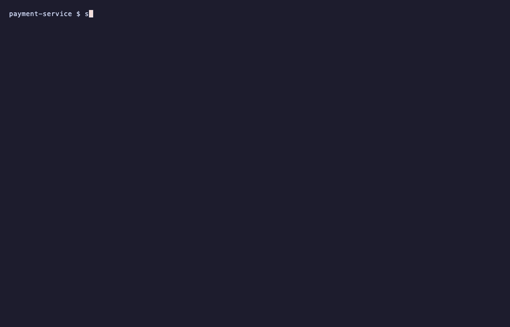

# The governance flight recorder for AI-written code

[](https://github.com/secuardenai/secuarden-cli/actions/workflows/test.yml?query=branch%3Amain)
[](https://github.com/secuardenai/secuarden-cli/releases/latest)
[](LICENSE)

Secuarden is a local-first CLI for developers, platform engineers, and security
teams who need to investigate AI-assisted changes. It captures evidence from
**Claude Code and compatible Codex runtimes**, so you can inspect agent activity,
verify stored records, and connect observations to committed changes.

v0.7.0 keeps that recorder local-only unless you configure a repository API key.
It also adds an opt-in local policy that can deny selected agent edits before
they run. No policy is active until you import one.

## New in v0.7.0

- Captured sessions keep their git branch and remote after later hook events
  arrive without a working directory.
- `secuarden report` resolves relative paths using the event directory, falling
  back to the session directory when the event supplies none. Paths inside that
  repository count as repository files.
  Paths outside it, and paths with no absolute directory to resolve against,
  stay external.
- `secuarden verify-live` exits 0 only after a persisted matching tool request
  and result. Arming a window, pending or incomplete verification, missing hook
  configuration, and errors exit non-zero. `init` itself still succeeds when it
  has installed hooks and armed the window.
- Operational failures from `init`, `verify-live`, `gate`, `sync`, and `serve`
  print the error without the command usage block. Unknown flags and unexpected
  arguments still print usage.
- Opt-in local policy enforcement v0.1 can protect configured Python route
  security decorators. See [Local policy enforcement](#local-policy-enforcement).

After v0.7.0 is published, upgrade from v0.6.0 with the installer. To install
this checkout beforehand, use `make install VERSION=v0.7.0-dev`. Then run
`secuarden hooks refresh` from the installed binary so existing hooks point at
it. Re-run live verification after refreshing hooks. Stored v0.6.0 sessions are
not rewritten. Identity retention applies to new hook events; the report can
also classify existing paths correctly when their captured directory context
is available. Previously lost Git identity is not reconstructed.

## Install and try it

You need Git, a local Git repository, and a supported agent that is ready to
run in that repository. Local capture does not require a Secuarden account.

```bash
curl -fsSL https://install.secuarden.ai | sh
cd /path/to/your/repository
secuarden init --repo .
```

These instructions describe **v0.7.0**. Until that release is published, the
installer may provide an earlier version. The installer selects the latest
published GitHub release, verifies the archive checksum, and copies `secuarden`
to `/usr/local/bin`. That directory must be writable. Build from this checkout
to try unreleased commits. See [Contributing](#contributing).

`init` always requires `--repo`, including inside a Git repository. It looks for
Claude Code's shared settings file (`~/.claude/settings.json`) or the official
Claude Code VS Code extension, and for a Codex CLI whose version and config
support hooks. Choose one agent with `--agent claude-code` or `--agent codex`.
Codex also needs project trust and, when you want Secuarden to turn the feature
on, `--enable-codex-hooks`. Detection does not sign you in to the agent. Follow
the setup diagnostics, then use a real agent session to confirm delivery. See
[agent setup](docs/setup.md#claude-code-and-codex-setup).

Run a session in that repository: ask the agent to read a file, make a small
change you can review, and run a relevant command. Then inspect:

```bash
secuarden status
secuarden events --last 20
secuarden serve
```

Open **http://127.0.0.1:8743** for the read-only local dashboard. `serve` accepts
only a loopback address. Setup alone does not produce a meaningful activity
history. If the log is empty, follow the
[capture checks](docs/setup.md#checking-capture).

`events` lists hook deliveries. A tool call normally appears twice, once for the
request and once for the reported result. `status` and `report` summarize those
deliveries into sessions, files, commands, and attention items. Unknown command
outcomes stay distinct from success.

A new repository stays local-only without an API key. Re-running setup preserves
existing sync settings. Capture scope defaults to all supported sessions for the
OS user; use `--scope repo` to limit it to the selected repository.

### Confirm capture works

`init` installs hooks and arms a 15-minute verification window. **Verification
pending** means setup completed and the window is armed. It does not mean a
client has delivered evidence. `verify-live` exits non-zero while the check is
pending, incomplete, or missing its hook configuration.

To start a fresh check for Codex in VS Code:

```bash
secuarden verify-live --repo . --agent codex --client vscode
```

Start a **new conversation in that repository**, ask it to run `pwd`, and obtain
that conversation's exact session ID from the client or its local session
record. Then check it within the window:

```bash
secuarden verify-live --repo . --agent codex --client vscode \
  --session EXACT_SESSION_ID --wait 60s
secuarden status
```

Replace `EXACT_SESSION_ID` with the actual ID. For Claude Code, use
`--agent claude-code` and the intended `--client` value (`vscode`, `desktop`,
`cli`, or `unknown`). A verified result, exit 0, establishes a persisted tool
request and matching result. It does not certify tool success, hash integrity,
checkpoint completeness, or SaaS delivery. The client label is user-declared.
With policy enforcement active, use an allowed file-read tool for the
verification round-trip instead of `pwd`, because shell tools are blocked.
See the [live-verification guide](docs/live-capture-verification.md).

### Platforms and agents

| Release build configuration | Architecture |
|---|---|
| macOS | Apple Silicon (ARM64), Intel (AMD64) |
| Linux | AMD64 |

Linux ARM64 and Windows binaries are not included. This matrix describes
configured release builds, not a claim that a fresh install has been validated
on every platform.

Claude Code is supported. Codex support depends on runtime hook capabilities and
required trust. Cursor, Copilot, and Windsurf integrations are not included.

## Demo



See repository-scoped setup, inspect captured activity and sensitive-path access,
and verify the stored evidence with the current CLI.

> Reproducible walkthrough using synthetic Claude Code hook payloads and actual
> CLI output. Runs in a disposable local environment; no live agent or SaaS call.
> The reported test failure is simulated. Hash verification checks stored records,
> not capture completeness. The raw fixtures replayed without working
> directories on later events remain checkpoint-partial; the walkthrough
> generator supplies those directories.

[Read the demo transcript](docs/demo/transcript.txt) ·
[Reproduce the demo](docs/demo/README.md)

## What you can inspect

- **Agent activity:** captured file reads and writes, commands and reported
  outcomes, MCP calls, sensitive-path access, and session identity.
- **Local summaries:** activity, agent, timeline, file, command, and attention
  views with drilldowns.
- **Evidence integrity:** per-session hash-chain verification and AI Bill of
  Materials (AI-BOM) export.
- **Committed changes:** Git-anchored change records, optional Codex observation
  coverage, and signed change receipts.

```bash
secuarden report --since 24h --md
secuarden ledger build --repo . --head HEAD --base BASE_COMMIT
```

`report` defaults to the Git repository containing the current directory. Use
`--repo` for another repository or `--all-repos` for every captured repository.
Relative captured paths resolve against the event's absolute working directory,
falling back to the session directory when the event supplies none. Paths outside
the repository root and paths without an absolute directory to resolve against
remain external. Reporting resolves directory aliases without rewriting stored
evidence.

Replace `BASE_COMMIT` with the intended ancestor commit or local ref.
`ledger build` records committed Git history from `--base` to `--head`.
Uncommitted work is excluded. `--base-ref origin/main` selects the merge-base of
`HEAD` and that ref. When `HEAD` and `origin/main` are the same commit, the
change record is empty. Pass an ancestor with `--base` to record the commits
after it. The ref must exist locally. See [activity commands](docs/activity.md)
and [ledger workflows](docs/ledger.md).

## Local policy enforcement

Policy enforcement is off until you import a bundle. v0.1 protects configured
Python route security decorators on supported file tools. The [example policy bundle](fixtures/policy/flask-security.json) covers common
Flask login and role decorators. Download that JSON file before importing it,
or run the following from a source checkout:

```bash
secuarden policy upload --file fixtures/policy/flask-security.json
secuarden policy list
```

Imported policies are stored at `~/.secuarden/policies.json` for the whole OS
user. They apply in every repository, including repositories outside the capture
scope. The next synchronous pre-tool hook loads them. `python3` 3.8 or newer
must be on the hook process `PATH`. The hook parses Python with `ast` and does
not import or execute project code.

While any v0.1 policy is active:

- Supported file tools are `Edit`, `Write`, `MultiEdit`, and exact-context Codex
  `apply_patch`. A change to a protected decorator stack is denied. A route-body
  edit that leaves that stack in place is allowed.
- Shell commands and unsupported tools are denied. Supported read/search tools
  remain allowed; run shell commands such as tests in your own terminal.
- A denial is returned to the agent and is not written to the capture database.
  Passive capture continues for tool calls the policy allows.
- A missing policy file leaves capture passive. An unreadable policy file denies
  tool calls.

This is decorator-syntax protection on hooked file operations. It is not an OS
sandbox and it does not prove that authentication works. Direct human edits,
disabled hooks, other processes, dynamic route registration, and changes to the
decorator's implementation are outside v0.1. There is no `policy remove` command
yet. To disable every imported policy and keep a backup:

```bash
mv ~/.secuarden/policies.json ~/.secuarden/policies.json.disabled
```

Details, the JSON contract, and the Flask demo are in
[local policy enforcement v0.1](docs/policy-v0.1.md).

## Privacy and optional sync

| Data | Default location |
|---|---|
| Captured activity | `~/.secuarden/secuarden.db` |
| Git ledger and signed receipts | `~/.secuarden/ledger.db` |
| Independent Codex observation inbox | `~/.secuarden/observations` |
| Repository integration settings | `~/.secuarden/config.json` |
| Local enforcement policies, when imported | `~/.secuarden/policies.json` |

Captured content is filtered using sensitive-path rules and secret-redaction
patterns before storage. These controls reduce exposure but do not guarantee
removal of all sensitive information. Sensitive paths can still appear as paths. Command output is stored as a short preview. Session records include the
OS user, a machine identifier derived from hostname and platform, and the git
identity available for that event. Treat the local database as sensitive.

Optional session sync sends repository and session metadata and redacted event
fields according to the
[upload contract](docs/contracts/session-upload-envelope.md). API keys and server
URLs are configured per repository, outside the worktree:

```bash
secuarden init --repo . --api-key YOUR_API_KEY
```

Omitting `--api-key` on a later setup run **does not disable existing sync**.
Signed receipt creation separately requires SaaS key registration and attempts
to upload its signed evidence envelope. Independent observation capture is
opt-in. Policy files are not part of session sync. See
[repository configuration](docs/setup.md) and
[receipts](docs/ledger.md#signed-change-receipts).

## What the evidence establishes

Secuarden records what supported hooks deliver. Missing hooks, unsupported
runtimes, or incomplete sessions leave gaps. Hash verification detects changes
to covered records. It does not establish complete capture or prove who wrote
every line. Observation correlations report inferred links and their limits.

Parallel tool calls can have complete request/result pairs while repository
checkpoints remain **partial** because their before/after snapshots overlap.
Live verification and checkpoint completeness are separate checks. A successful
round-trip does not remove checkpoint uncertainty.

With no policy imported, capture records tool activity and does not decide
whether an edit may proceed. With a v0.1 policy imported, the pre-tool hook can
deny the supported edits and shell commands described above. Denied proposals
are absent from the activity log.

Secuarden complements code and security scanners. It does not replace SAST,
secret scanning, dependency analysis, prompt-injection testing, or organizational
approval controls. Its CI gate evaluates captured evidence against deterministic
path and risk rules. Synchronous hooks, policy evaluation, and network
operations can add latency.

## Verify, export, and gate

```bash
secuarden verify                       # current Git repository
secuarden verify --repo /path/to/repo
secuarden verify --all                 # entire local audit database
secuarden bom --since 30d > secuarden-ai-bom.json
secuarden gate --since 24h --fail-on high
```

Run these where the relevant captured database is available. A clean CI runner
does not automatically have evidence from a developer's machine. Legacy records
without complete hashing cannot gain integrity coverage retroactively. See
[verification behavior](docs/activity.md#provenance-integrity-and-ci-gate).

## Guides

- [Setup, agent configuration, capture checks, and uninstall](docs/setup.md)
- [Live capture verification and troubleshooting](docs/live-capture-verification.md)
- [Activity commands, dashboard, reports, and verification](docs/activity.md)
- [Git ledger, Codex observations, and signed receipts](docs/ledger.md)
- [Local policy enforcement v0.1](docs/policy-v0.1.md)
- [Architecture and evidence contracts](docs/architecture.md)

## Contributing

Documentation fixes, synthetic hook fixtures, redaction improvements, and agent
integrations are welcome. Open an issue before starting significant work.

Building requires Go 1.25 or newer and Git. From this checkout:

```bash
make build
make test
./bin/secuarden --help
```

Use a stable installed binary for setup. `make install` copies it to
`/usr/local/bin/secuarden` and requires write access there. After upgrading,
run `secuarden hooks refresh` so installed hooks use that path. Avoid `go run`
for setup or hook installation, because hooks store the executable's path.

## License

[Apache 2.0](LICENSE). Built by [Secuarden](https://secuarden.ai).
