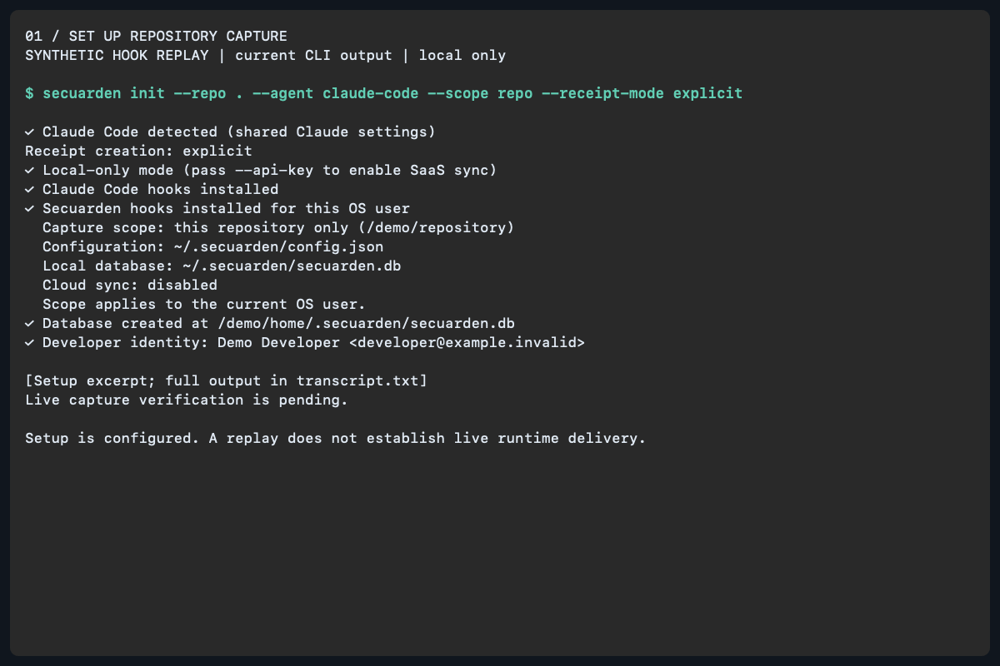

# The governance flight recorder for AI-written code

[](https://github.com/secuardenai/secuarden-cli/actions/workflows/test.yml?query=branch%3Amain)
[](https://github.com/secuardenai/secuarden-cli/releases/latest)
[](LICENSE)

Secuarden is a local-first CLI for developers, platform engineers, and security
teams who need to investigate AI-assisted changes. It captures evidence from
**Claude Code and compatible Codex runtimes**, so you can inspect agent activity,
verify stored records, and connect observations to committed changes.

## Install and try it

You need Git, a local Git repository, and an installed, authenticated supported
agent. Local capture does not require a Secuarden account.

```bash
curl -fsSL https://install.secuarden.ai | sh
cd /path/to/your/repository
secuarden init --repo .
```

These workflows are included in **v0.6.0**. The installer downloads the latest
published release. See the [v0.6.0 release notes](docs/releases/v0.6.0.md) for
features and upgrade guidance, or [build from source](#contributing) to try `main`.

Setup detects supported agents. Choose explicitly with `--agent claude-code` or
`--agent codex`. Codex requires compatible hooks, configuration, and trust; follow
the setup diagnostics. See [agent setup](docs/setup.md#claude-code-and-codex-setup).

Now run a real session with your agent in that repository: ask it to read a file,
make a small change you can review, and run a relevant command. Then inspect:

```bash
secuarden status
secuarden events --last 20
secuarden serve
```

Open **http://127.0.0.1:8743** for the read-only local dashboard. Setup alone does
not produce a meaningful activity history. If the log is empty, follow the
[capture checks](docs/setup.md#checking-capture).

A new repository stays local-only without an API key. Re-running setup preserves
existing sync settings. Capture scope defaults to all supported sessions for the
OS user; use `--scope repo` to limit it to the selected repository.

### Confirm capture works

`init` installs hooks and arms a 15-minute verification window. **Verification
pending** means setup completed, but runtime delivery has not yet been confirmed.
To start a fresh check for Codex in VS Code:

```bash
secuarden verify-live --repo . --agent codex --client vscode
```

Start a **new conversation in that repository**, ask it to run `pwd`, and obtain
that conversation's exact session ID from the client or its associated local
session record. Then check it within the window:

```bash
secuarden verify-live --repo . --agent codex --client vscode \
  --session EXACT_SESSION_ID --wait 60s
secuarden status
```

Replace `EXACT_SESSION_ID` with the actual ID. For Claude Code, use
`--agent claude-code` and the appropriate intended `--client` value.
A verified result establishes a persisted tool request and matching result;
it does not certify tool success, hash integrity, or SaaS delivery. The client
label is user-declared, not independently established by hook evidence.
See the [live-verification guide](docs/live-capture-verification.md) for activation,
exact-session selection, pending results, and stale verification diagnostics.

### Platforms and agents

| Release build configuration | Architecture |
|---|---|
| macOS | Apple Silicon (ARM64), Intel (AMD64) |
| Linux | AMD64 |

Linux ARM64 and Windows binaries are not currently included in the release
configuration. This matrix describes configured builds, not a claim that fresh
installation has been validated on every platform.

Claude Code is supported. Codex support depends on runtime hook capabilities and
required trust. Cursor, Copilot, and Windsurf integrations are not included.

## Demo



See repository-scoped setup, inspect captured activity and sensitive-path access,
and verify the stored evidence with the current CLI.

> Reproducible walkthrough using synthetic Claude Code hook payloads and actual
> CLI output. Runs in a disposable local environment; no live agent or SaaS call.
> The reported test failure is simulated. Hash verification checks stored records,
> not capture completeness.

[Read the demo transcript](docs/demo/transcript.txt) ·
[Reproduce the demo](docs/demo/README.md)

## What you can inspect

- **Agent activity:** captured file reads and writes, commands and reported
  outcomes, MCP calls, sensitive-path access, and session identity.
- **Local summaries:** activity, agent, timeline, file, command, and attention
  views with drilldowns. Unknown command outcomes remain distinct from success.
- **Evidence integrity:** per-session hash-chain verification and AI Bill of
  Materials (AI-BOM) export.
- **Committed changes:** Git-anchored change records, optional Codex observation
  coverage, and signed change receipts.

```bash
secuarden report --since 24h --md
secuarden ledger build --repo . --head HEAD --base-ref origin/main
```

The ledger example requires a locally available `origin/main` ref. It records
committed changes; uncommitted work is excluded. See [activity commands](docs/activity.md)
and [ledger workflows](docs/ledger.md) for the full instructions.

## Privacy and optional sync

| Data | Default location |
|---|---|
| Captured activity | `~/.secuarden/secuarden.db` |
| Git ledger and signed receipts | `~/.secuarden/ledger.db` |
| Independent Codex observation inbox | `~/.secuarden/observations` |
| Repository integration settings | `~/.secuarden/config.json` |

Activity capture applies sensitive-path detection and secret-redaction patterns
before storage. Sensitive paths may still appear as evidence. Redaction reduces
exposure; captured metadata should still be treated as sensitive.

Optional session sync sends repository/session metadata and redacted event fields
according to the [upload contract](docs/contracts/session-upload-envelope.md).
API keys and server URLs are configured per repository, outside the worktree:

```bash
secuarden init --repo . --api-key YOUR_API_KEY
```

Omitting `--api-key` on a later setup run **does not disable existing sync**.
Signed receipt creation separately requires SaaS key registration and attempts
to upload its signed evidence envelope. Independent observation capture is
opt-in. See [repository configuration](docs/setup.md) and [receipts](docs/ledger.md#signed-change-receipts).

## What the evidence establishes

Secuarden records what supported hooks deliver. Missing hooks, unsupported
runtimes, or incomplete sessions can leave gaps. Hash verification detects
changes to covered records; it does not establish complete capture or prove who
wrote every line. Observation correlations report inferred links and limitations.

Parallel tool calls can have complete request/result pairs while repository
checkpoints remain **partial** because their before/after snapshots overlap.
Live verification and checkpoint completeness are separate checks; a successful
round-trip does not remove checkpoint uncertainty.

Secuarden complements code and security scanners. It does not replace SAST,
secret scanning, dependency analysis, prompt-injection testing, or organizational
approval controls. Its CI gate evaluates captured evidence against deterministic
risk thresholds. Capture does not direct the agent's edits; synchronous hooks
and network operations can add latency.

## Verify, export, and gate

```bash
secuarden verify                       # current Git repository
secuarden verify --repo /path/to/repo
secuarden verify --all                 # entire local audit database
secuarden bom --since 30d > secuarden-ai-bom.json
secuarden gate --since 24h --fail-on high
```

Run these where the relevant captured database is available. A clean CI runner
does not automatically have evidence from a developer's machine. Legacy records
without complete hashing cannot gain integrity coverage retroactively; see
[verification behavior](docs/activity.md#provenance-integrity-and-ci-gate).

## Guides

- [Setup, agent configuration, capture checks, and uninstall](docs/setup.md)
- [Live capture verification and troubleshooting](docs/live-capture-verification.md)
- [Activity commands, dashboard, reports, and verification](docs/activity.md)
- [Git ledger, Codex observations, and signed receipts](docs/ledger.md)
- [Architecture and evidence contracts](docs/architecture.md)

## Contributing

Documentation fixes, synthetic hook fixtures, redaction improvements, and agent
integrations are welcome. Open an issue before starting significant work.

Building requires Go 1.25 or newer and Git. From this checkout:

```bash
make build
make test
./bin/secuarden --help
```

Use a stable installed binary for setup: `make install` copies it to
`/usr/local/bin/secuarden` and requires write access there. Avoid `go run` for
setup or hook installation because hooks reference the executable's path.

## License

[Apache 2.0](LICENSE). Built by [Secuarden](https://secuarden.ai).
